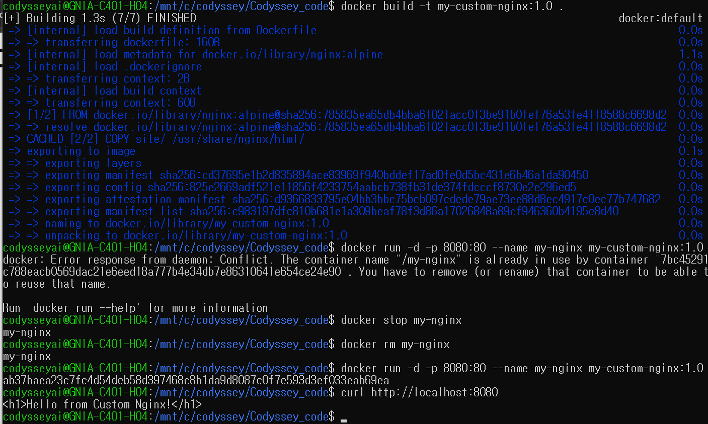
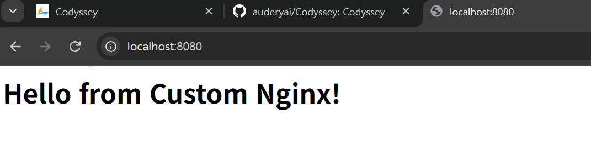

# Docker 커스텀 이미지 실습

## 실습 목표
- nginx:alpine 기반 커스텀 Docker 이미지 생성
- Dockerfile 작성 및 이미지 빌드
- 컨테이너 실행 및 동작 확인

## Dockerfile 구성
- **베이스 이미지**: nginx:alpine
- **LABEL**: 작성자 정보 포함
- **ENV**: 환경변수 설정
- **COPY**: 커스텀 HTML 파일 복사

## 실습 과정

### 1. 이미지 빌드
docker build -t my-nginx .

### 2. 컨테이너 실행
docker run -d -p 8080:80 my-nginx

## 스크린샷

### 이미지 빌드

### 컨테이너 실행

